<div align="center">

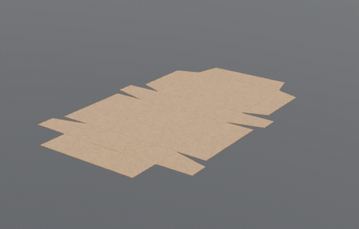

# Cut & Render

**Z tvaru na strih. Zo strihu na fotku.**

Webové štúdio, ktoré z parametrov alebo 3D modelu vyrobí presný strihový plán v milimetroch, pustí naň potlač a ukáže výsledok vo fotorealistickom 3D, ktoré sa renderuje priamo v prehliadači.

[](https://cut-and-render.replit.app)

[](#technológie)
[](#technológie)
[](#3d-a-path-tracing)
[](#technológie)
[](#backend-a-dáta)
[](#štruktúra-projektu)
[](LICENSE)

[Čo to robí](#čo-to-robí) ·
[Galéria](#galéria) ·
[3D model](#vyskúšajte-3d-priamo-tu) ·
[Ako to funguje](#ako-to-funguje) ·
[Spustenie](#spustenie) ·
[API](#api) ·
[FAQ](#časté-otázky)

</div>

<details>
<summary><b>English summary</b></summary>

<br>

Cut & Render is a browser-based production studio for **apparel patterns, packaging dielines and paint-protection-film (PPF) cut plans**. Parameters (or an imported 3D model) produce a millimetre-accurate cut plan. You can place printed artwork on the pattern pieces, see the product in a **path-traced 3D view** and export **SVG, DXF, PDF (1:1), JSON** or a PNG render. The UI is in Slovak. Live app: <https://cut-and-render.replit.app>

</details>

---

## Čo to robí

Nasadenie mimo Replitu: [Render + Neon + Cloudflare R2](docs/deployment-render.md)
vrátane automatického nasadenia z GitHubu a prenosu existujúcich dát.

| | Odevy | Obaly | PPF fólia |
|---|---|---|---|
| **Vstup** | strih + veľkosť XS–XXL, voľnosť, rukáv, prídavky | konštrukcia FEFCO/ECMA, rozmery, hrúbka lepenky | vlastný 3D model (STEP, STL, GLB…) alebo ukážka |
| **Výpočet** | odstupňované diely so švovými prídavkami, zárezmi a smerom osnovy | výsekové a ohybové čiary, lepiace chlopne, spadávka | rozdelenie povrchu podľa uhla, rozvinutie do roviny (LSCM), správa o napätí |
| **Uloženie** | na šírku látky | na hárok | na rolu fólie |
| **3D** | ušité tričko s potlačou, vráskami a vešiakom | živé skladanie siete do krabice | fólia na laku auta |
| **Navyše** | obrázky a texty na dieloch | 4 konštrukcie | 7 lakov karosérie |

> [!TIP]
> Všetky rozmery sú v **milimetroch** a exporty PDF sú v mierke **1 : 1**. Vytlačený strih sa dá priamo priložiť na látku alebo lepenku.

### Kľúčové funkcie

- [x] **Parametrické strihy:** tričko, mikina, nohavice, sukňa a plátenná taška.
- [x] **Potlač:** obrázky a texty na prednom, zadnom diele a rukávoch.
  - Vrstvy sa dajú skryť, posúvať, zväčšovať a otáčať myšou aj prstom.
  - Predvolené umiestnenia: stred hrude, ľavá hruď, celá predná strana.
  - 10 písiem (Anton, Bebas Neue, Oswald, Pacifico…).
- [x] **Obaly:** FEFCO 0201, ECMA A20.20, FEFCO 0427 a FEFCO 0300 s animáciou skladania.
- [x] **PPF:** import 11 formátov vrátane CAD (STEP/IGES/BREP cez OpenCascade vo WebAssembly).
- [x] **Fotorealistický render:** path tracing na GPU, ktorý sa po 400 ms nečinnosti kamery postupne zostrí.
- [x] **5 svetelných prostredí:** fotoštúdio, softbox, dielňa, zlatá hodinka a nočný showroom.
- [x] **18 materiálov s fyzikálnymi parametrami:** gramáž, pružnosť, drsnosť, sheen, číry lak.
- [x] **Exporty:** SVG, DXF, PDF 1:1, JSON a PNG snímka.
- [x] **Rozloženie Strih / Split / 3D**, ktoré funguje aj na mobile.
- [x] **Automatické ukladanie** projektov a denník aktivít.

---

## Galéria

<table>
<tr>
<td width="50%">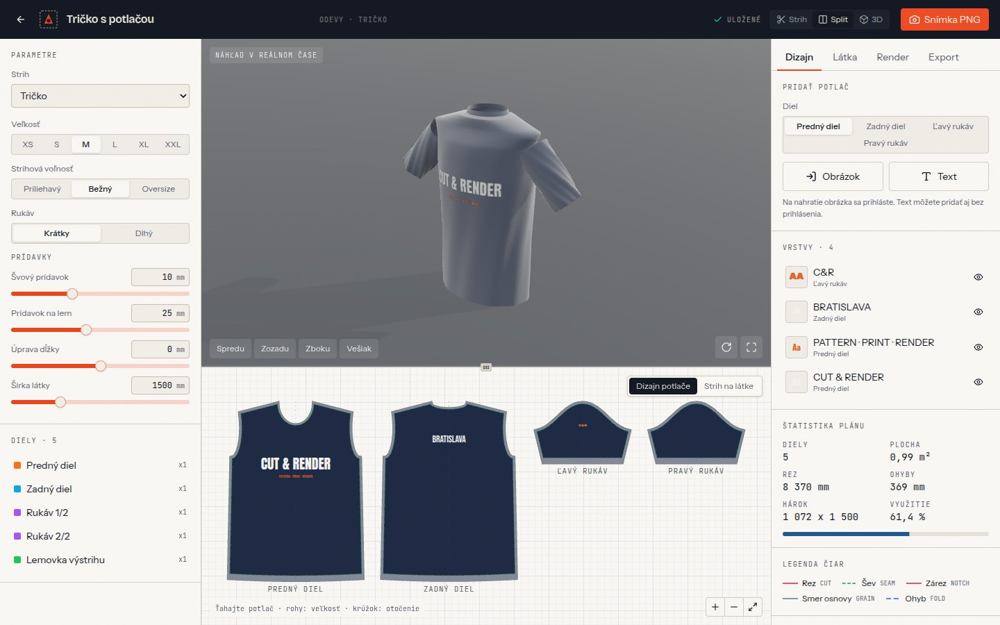</td>
<td width="50%">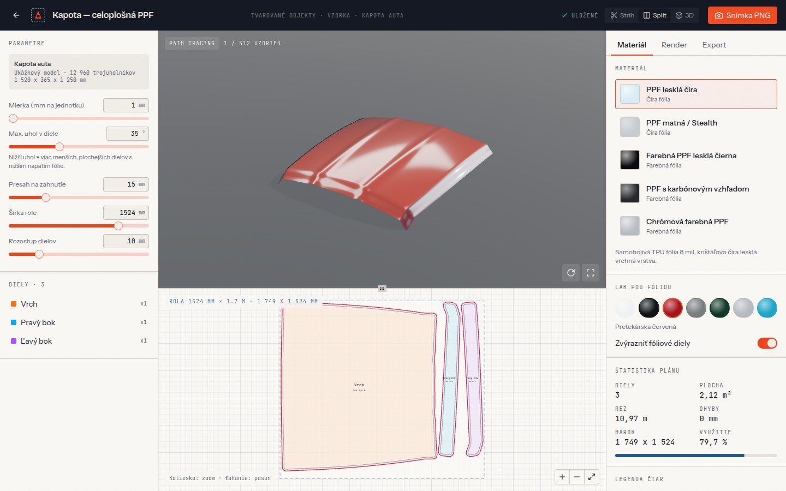</td>
</tr>
<tr>
<td><b>Odevy:</b> potlač sa zobrazuje naraz na 3D tričku aj na strihových dieloch.</td>
<td><b>PPF:</b> kapota rozdelená na 3 diely fólie, uložené na role 1524 mm.</td>
</tr>
<tr>
<td>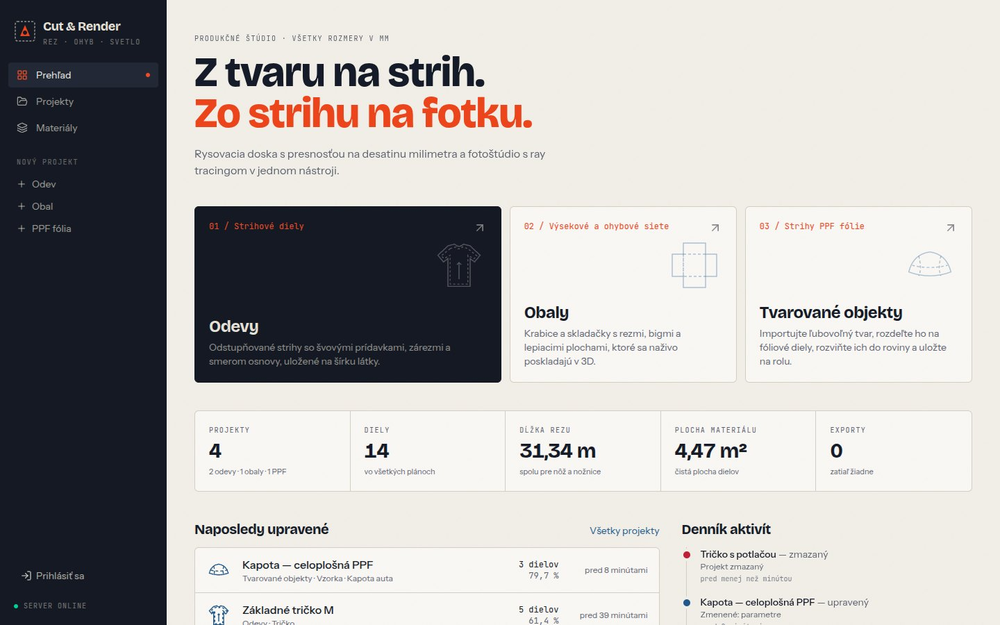</td>
<td>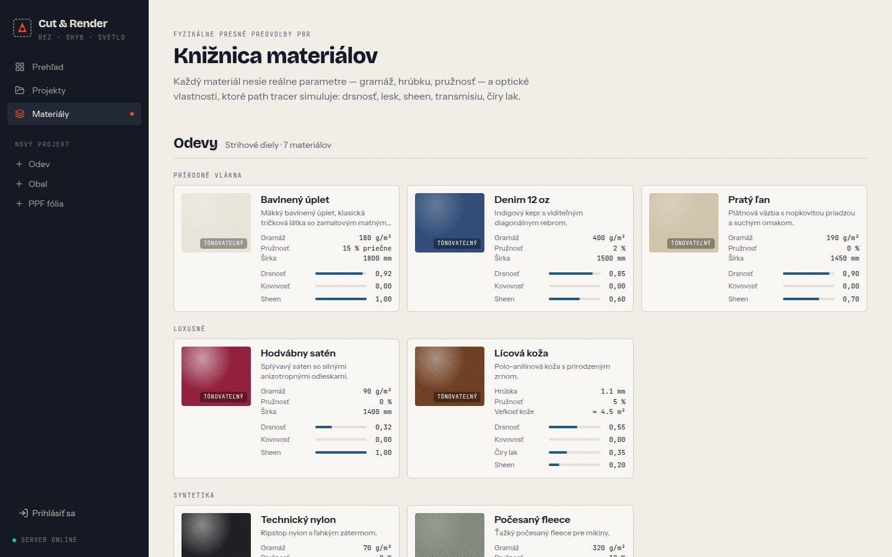</td>
</tr>
<tr>
<td><b>Prehľad:</b> súhrny všetkých plánov (dĺžka rezu, plocha, exporty).</td>
<td><b>Materiály:</b> fyzikálne presné predvoľby PBR.</td>
</tr>
</table>

---

## Ako to funguje

### Tok dát

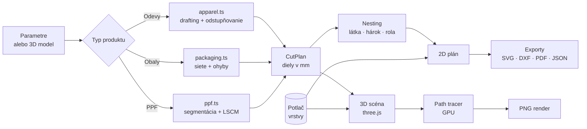

Celá geometria sa počíta **v prehliadači**. Server iba ukladá projekty a plány ako JSON, takže každá zmena parametra sa prejaví okamžite.

<details>
<summary><b>Odevy: ako vzniká strih a potlač</b></summary>

<br>

1. Z veľkosti a voľnosti sa vypočítajú miery (hrudník, dĺžka, priekrčník, prieramok).
2. Diely sa narysujú v ich vlastnom súradnicovom systéme: x = 0 je stred, y sa meria od ramenného bodu.
3. Pridajú sa švové prídavky, zárezy a smer osnovy. Zrkadlené diely sa uložia na šírku látky.
4. Vrstvy potlače žijú **v súradniciach dielu**. Jedna sada dát preto poháňa tri miesta:
   - dizajnovú plochu (SVG),
   - textúry na 3D modeli (canvas, prekresľujú sa bez prestavby geometrie),
   - exporty SVG a PDF (orezané na reznú čiaru).
5. Potlač sa na zrkadlených kópiách dielov nikdy nezrkadlí.

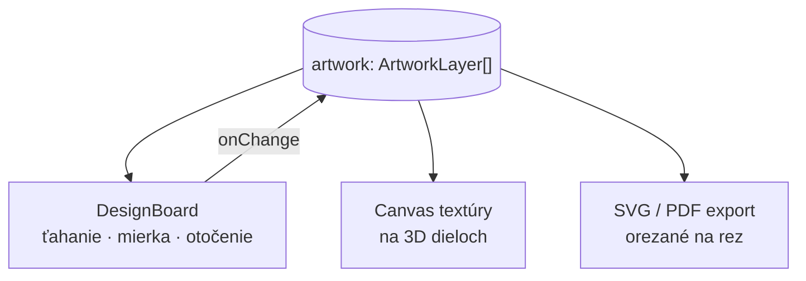

</details>

<details>
<summary><b>Obaly: skladanie siete</b></summary>

<br>

Každý panel siete je samostatné teleso s reálnou hrúbkou lepenky. Panely tvoria strom spojený pántmi (ohybovými čiarami). Každý pánt má cieľový uhol a vlastné **časové okno** v animácii skladania, takže chlopne sa skladajú v správnom poradí. Prekrývajúce sa chlopne sa posúvajú o násobky hrúbky materiálu, aby sa neprenikali.

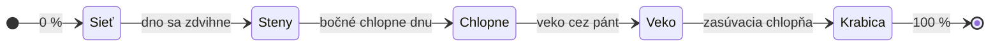

| Konštrukcia | Kód | Typický materiál |
|---|---|---|
| Klopová krabica | FEFCO 0201 | vlnitá lepenka 3 mm |
| Skladačka so zasúvacími koncami | ECMA A20.20 | kartón 0,5 mm |
| Poštová krabica | FEFCO 0427 | vlnitá lepenka 1,5 mm |
| Otvorený podnos | FEFCO 0300 | vlnitá lepenka 1,5 mm |

</details>

<details>
<summary><b>PPF: z 3D modelu na rolu fólie</b></summary>

<br>

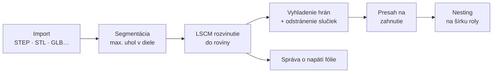

- Nižší maximálny uhol znamená viac menších a plochejších dielov s nižším napätím fólie.
- Importované modely zostávajú **iba v prehliadači** (IndexedDB). Na inom zariadení vás aplikácia požiada o opätovný import.
- `.blend` a `.uasset` sa nedajú čítať priamo. Exportujte ich najprv do GLB alebo FBX.

| Rodina | Formáty |
|---|---|
| Siete | STL, OBJ, PLY, 3MF |
| Scény | glTF/GLB, FBX, Collada, USDZ |
| CAD | STEP, IGES, OpenCascade BREP |

</details>

### 3D a path tracing

<details>
<summary><b>Ako vzniká fotorealistický obraz</b></summary>

<br>

- **Náhľad v reálnom čase:** klasický rasterizovaný obraz (three.js, AgX tone mapping, mäkké tiene), keď hýbete kamerou alebo meníte parametre.
- **Path tracing:** po 400 ms bez pohybu sa spustí [three-gpu-pathtracer](https://github.com/gkjohnson/three-gpu-pathtracer). Obraz sa zjemňuje vzorka po vzorke až do nastaveného limitu (predvolene 512) a potom sa zobrazí štítok „Vyvolané“.
- **Prostredia** sú procedurálne HDR mapy (half-float), žiadne externé súbory.
- **Materiály** používajú `MeshPhysicalMaterial`: sheen pre látky, číry lak pre lak auta a laminát, transmisiu pre fóliu, anizotropiu pre satén.

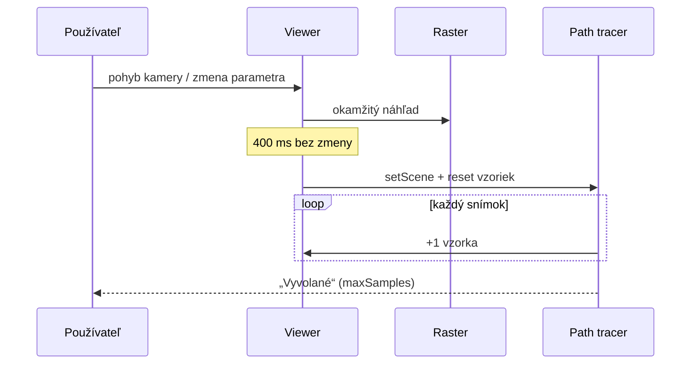

</details>

### Backend a dáta

<details>
<summary><b>Ukladanie projektov, prihlásenie a nahrávanie obrázkov</b></summary>

<br>

- **Projekty** (parametre, plán, nastavenia renderu, potlač) sú v PostgreSQL cez Drizzle ORM. Ukladajú sa automaticky 900 ms po poslednej zmene.
- **Prihlásenie** (Clerk) treba **iba na nahrávanie obrázkov**. Prehľad, projekty aj text na potlač fungujú bez účtu.
- **Obrázky** idú priamo z prehliadača do objektového úložiska cez predpodpísanú URL. Server pustí len PNG, JPEG, WebP, SVG a GIF do 25 MB.

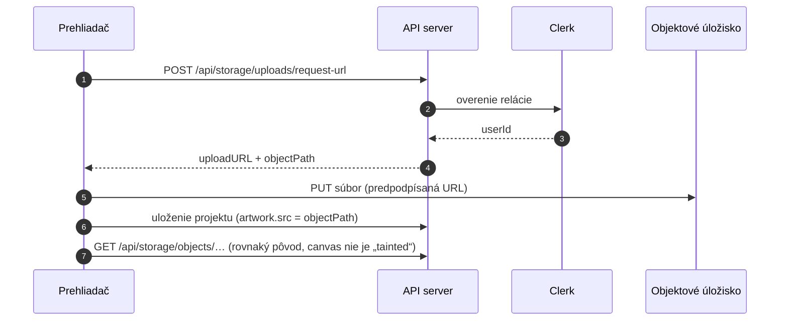

</details>

---

## Spustenie

> [!IMPORTANT]
> Projekt je **pnpm monorepo**. npm ani yarn nefungujú (skript `preinstall` ich odmietne).

```bash
git clone https://github.com/bucala/Cut-Render.git
cd Cut-Render
pnpm install

# API server (Express 5)
pnpm --filter @workspace/api-server run dev

# webová aplikácia (Vite)
pnpm --filter @workspace/cut-render run dev
```

<details>
<summary><b>Premenné prostredia</b></summary>

<br>

| Premenná | Kde | Na čo |
|---|---|---|
| `DATABASE_URL` | API | PostgreSQL |
| `CLERK_SECRET_KEY` | API | overenie prihlásenia |
| `CLERK_PUBLISHABLE_KEY` / `VITE_CLERK_PUBLISHABLE_KEY` | API / web | Clerk klient |
| `DEFAULT_OBJECT_STORAGE_BUCKET_ID` | API | bucket pre obrázky potlače |
| `PRIVATE_OBJECT_DIR`, `PUBLIC_OBJECT_SEARCH_PATHS` | API | cesty v úložisku |
| `SESSION_SECRET` | API | podpis relácií |
| `PORT`, `BASE_PATH` | oba | port a cesta služby |

Hodnoty nikdy necommitujte. Na Replite sa nastavujú v paneli Secrets.

</details>

<details>
<summary><b>Užitočné príkazy</b></summary>

<br>

```bash
pnpm run typecheck                       # typy celého monorepa
pnpm run build                           # typecheck + build všetkých balíkov
pnpm --filter @workspace/api-spec run codegen   # klient a Zod schémy z OpenAPI
pnpm --filter @workspace/db run push     # schéma databázy (Drizzle)
```

</details>

---

## Štruktúra projektu

<details open>
<summary><b>Strom priečinkov</b></summary>

```text
.
├── artifacts/
│   ├── cut-render/              # webová aplikácia (React 19 + Vite 7)
│   │   └── src/
│   │       ├── engine/          # geometria a 3D, bez závislosti na Reacte
│   │       │   ├── apparel.ts       # strihy odevov, odstupňovanie, nesting na látku
│   │       │   ├── packaging.ts     # siete obalov, skladanie v 3D
│   │       │   ├── ppf.ts           # segmentácia, LSCM, nesting na rolu
│   │       │   ├── artwork.ts       # vrstvy potlače: kreslenie, SVG, 3D textúry
│   │       │   ├── importers.ts     # detekcia formátov, OCCT wasm pre CAD
│   │       │   ├── viewer.ts        # three.js + path tracer
│   │       │   ├── exporters.ts     # SVG, DXF, PDF, JSON
│   │       │   └── materials.ts     # PBR predvoľby
│   │       ├── components/      # DesignBoard, PlanCanvas, ArtworkPanel…
│   │       └── pages/           # prehľad, projekty, štúdio, materiály
│   └── api-server/              # Express 5: projekty, exporty, aktivita, úložisko
├── lib/
│   ├── api-spec/openapi.yaml    # zmluva API (zdroj pravdy)
│   ├── api-client-react/        # vygenerované React Query hooky (Orval)
│   ├── api-zod/                 # vygenerované Zod schémy
│   └── db/                      # Drizzle schéma (projects, project_exports, activity)
└── docs/readme/                 # obrázky a 3D model pre tento README
```

</details>

---

## API

Zmluva je v [`lib/api-spec/openapi.yaml`](lib/api-spec/openapi.yaml). Klient aj validácia sa z nej generujú.

| Metóda | Cesta | Popis |
|---|---|---|
| `GET` | `/api/healthz` | stav servera |
| `GET` · `POST` | `/api/projects` | zoznam / vytvorenie projektu |
| `GET` | `/api/projects/summary` | súhrnné štatistiky |
| `GET` · `PATCH` · `DELETE` | `/api/projects/{id}` | projekt s plánom |
| `POST` | `/api/projects/{id}/duplicate` | kópia projektu |
| `GET` · `POST` | `/api/projects/{id}/exports` | história exportov |
| `GET` | `/api/activity/recent` | denník aktivít |
| `POST` | `/api/storage/uploads/request-url` | URL na nahranie obrázka 🔒 |
| `GET` | `/api/storage/objects/{path}` | nahraný obrázok |

🔒 vyžaduje prihlásenie.

---

## Technológie

<table>
<tr><td><b>Frontend</b></td><td>React 19, Vite 7, Tailwind CSS 4, Radix UI, wouter, TanStack Query</td></tr>
<tr><td><b>3D</b></td><td>three.js r187, three-gpu-pathtracer, occt-import-js (OpenCascade → WebAssembly)</td></tr>
<tr><td><b>Exporty</b></td><td>vlastný SVG/DXF zapisovač, jsPDF (1:1)</td></tr>
<tr><td><b>Backend</b></td><td>Node.js, Express 5, Drizzle ORM, PostgreSQL, Zod</td></tr>
<tr><td><b>Auth a úložisko</b></td><td>Clerk, objektové úložisko s predpodpísanými URL</td></tr>
<tr><td><b>Nástroje</b></td><td>pnpm workspaces, TypeScript 5.9 project references, Orval codegen, esbuild</td></tr>
</table>

---

## Časté otázky

<details>
<summary><b>Prečo je 3D obraz chvíľu zrnitý?</b></summary>

<br>

To je path tracing v akcii: každá vzorka pridá ďalší lúč svetla na pixel. Po pár sekundách bez pohybu kamery sa obraz vyčistí. Na slabších zariadeniach znížte v karte **Render** počet vzoriek alebo path tracing vypnite.

</details>

<details>
<summary><b>Kde sa ukladá môj 3D model pre PPF?</b></summary>

<br>

Iba vo vašom prehliadači (IndexedDB). Na server sa neposiela, ukladá sa len vygenerovaný plán. Na inom zariadení model importujete znova.

</details>

<details>
<summary><b>Obsahuje DXF aj potlač?</b></summary>

<br>

Nie. DXF je určený pre rezacie plotre a nesie len čiary (rez, šev, ohyb, zárez, osnova). Potlač je v exportoch **SVG** (obrázky vložené priamo v súbore) a **PDF** (rastrovaná na každom potlačenom diele).

</details>

<details>
<summary><b>Potrebujem účet?</b></summary>

<br>

Len na nahrávanie vlastných obrázkov na potlač. Všetko ostatné funguje bez prihlásenia.

</details>

<details>
<summary><b>Funguje to na mobile?</b></summary>

<br>

Áno. Štúdio sa na telefóne poskladá pod seba: 3D, dizajnová plocha, parametre. Prepínačom **Strih / Split / 3D** si zväčšíte to, čo práve potrebujete.

</details>

---

<div align="center">

<sub>Licencia <a href="LICENSE">MIT</a> · postavené na <a href="https://replit.com">Replite</a> · <a href="https://cut-and-render.replit.app">cut-and-render.replit.app</a></sub>

</div>
